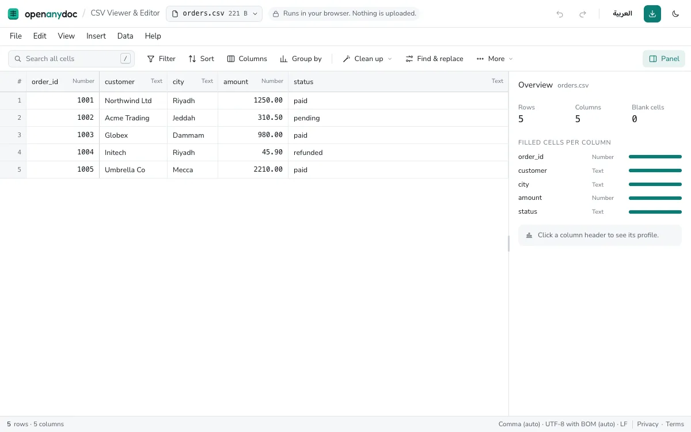
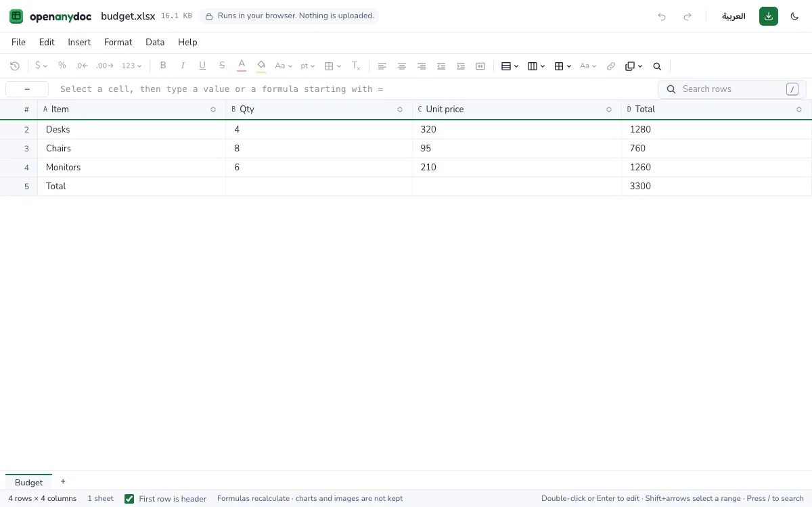
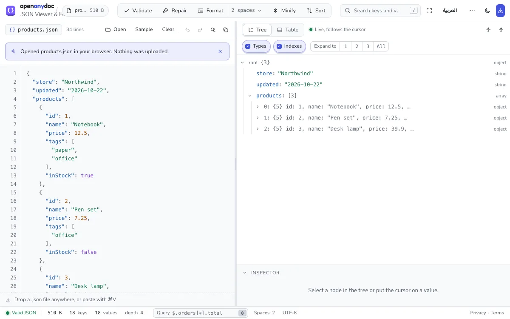
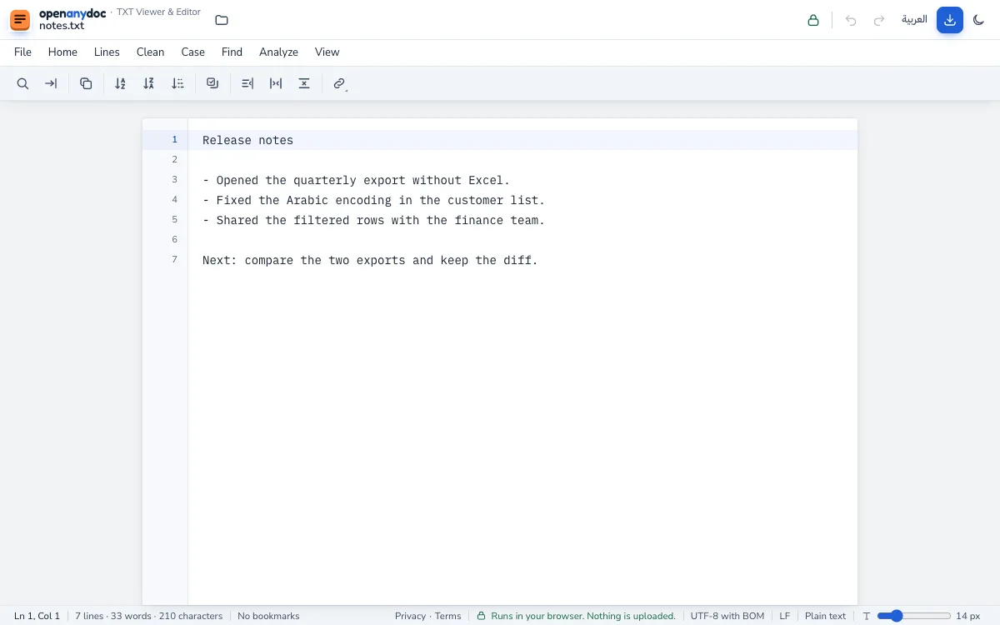

# OpenAnyDoc

**Free online viewer and editor for CSV, Excel, JSON and TXT files. Files stay in your browser: nothing is uploaded.**

Live site: **https://www.openanydoc.com** (English) · https://www.openanydoc.com/ar (Arabic)

Drop a file on the page. Your browser reads it, draws it, lets you search, sort, filter and edit it, and downloads a copy in the same format. There is no server that ever sees the file, no sign-up, no cookies and no analytics.



## Nothing is uploaded, and you can check

The privacy rule is enforced, not promised:

1. Open the site, press **F12** (DevTools) and open the **Network** tab.
2. Drop any file on the page, even a 50 MB one.
3. You will see **no request** leave your browser. The file is read with the browser's own File API and drawn on screen.

Behind that:

- The site's `Content-Security-Policy` is `default-src 'self'` with `connect-src 'self'`: the browser itself refuses any request to another origin. The only inline code is the theme script and the stylesheet, both allowed by their SHA-256 hashes.
- `npm run test:privacy` drives headless Chrome over the DevTools protocol through every page and every viewer, and **fails the build** on any `fetch`, XHR, beacon, WebSocket, cookie, IndexedDB, Cache API, service worker, or any browser-storage write other than the theme choice.
- No analytics, no fonts from a font host, no third-party script. Fonts and icons are bundled.

## What it opens

| Format | Files | What you can do | Limits |
|---|---|---|---|
| CSV | `.csv` `.tsv` `.tab` | Delimiter (comma, semicolon, tab, pipe) and encoding detected; search, filter, multi-column sort, column profiles; edit cells, rows and columns; find and replace; clean-up tools; download with your choice of delimiter, quotes, line endings and only the shown rows | No row limit of its own; 120,000 rows open in under a second; a warning above 50 MB |
| Excel | `.xlsx` `.xls` `.xlsm` `.ods` | Every sheet with values, formulas that recalculate, number formats and merged cells; fonts, colours and fills for `.xlsx`/`.xlsm`; edit cells, rows, columns and sheets; bold, italic, colours, fills and alignment saved for `.xlsx` | Styles read up to 8 MB; charts, images, pivot tables, conditional formats, data validation, defined names and macros are not kept on save |
| JSON | `.json` or pasted text | Tree, table and text views; validate with the line and column of an error; repair comments, trailing commas, single quotes and unquoted keys; format with 1–8 spaces or a tab, minify, sort keys; integers beyond 2^53 kept exactly | 10 MB; the text pane starts closed above 5 MB |
| TXT | `.txt` | Line numbers, find and replace with regular expressions, case, whitespace, sort and duplicate tools, bookmarks; save as UTF-8, UTF-8 with BOM, UTF-16 or Windows-1256 with LF, CRLF or CR | A 46 MB file has been tested; a fast read view above 2 million characters |

Encodings on every text format: UTF-8 with or without a BOM, UTF-16, and Windows-1256 for older Arabic files. Arabic text is shown right to left; the "Excel copy" button writes a UTF-8 BOM so Excel stops showing Arabic as symbols.

Word, PDF and PowerPoint are planned and not built yet.





## Guides

Short, practical answers to the problems people hit with these files, each with the tool that fixes it:

- [Why your CSV shows broken Arabic text in Excel](https://www.openanydoc.com/en/fix-arabic-csv-in-excel)
- [CSV opens in one column in Excel: how to fix the delimiter](https://www.openanydoc.com/en/csv-opens-in-one-column)
- [CSV too big for Excel: the 1,048,576-row limit and what to do](https://www.openanydoc.com/en/csv-too-big-for-excel)
- [JSON "unexpected token" errors: find the line and fix it](https://www.openanydoc.com/en/json-unexpected-token)

All guides: https://www.openanydoc.com/en/guides

## Run it yourself

Requirements: Node.js 22.6 or newer (the build script reads TypeScript directly with `--experimental-strip-types`), npm, and for the tests and screenshots Google Chrome.

```sh
git clone https://github.com/shahzad-35/openanydoc.git
cd openanydoc
npm install
npm run dev          # http://localhost:5173
```

Other commands:

```sh
npm run build        # type-check, bundle, prerender every page in English and Arabic, write sitemap.xml, robots.txt and the 404 pages into dist/
npm run test:privacy # build, then the privacy and behaviour suite in headless Chrome (79 tests)
npm run lint         # oxlint
npm run og:images    # draw the share pictures (public/og/) with headless Chrome
node --experimental-strip-types scripts/take-screenshots.mjs   # the viewer screenshots in this README (needs cwebp)
```

Because the site is a folder of static files, an organisation can host its own copy on an internal network: build it, serve `dist/` from any web server, and the files employees open never leave their devices.

## How it is built

- Vite, React 19, TypeScript and Tailwind CSS v4; no router package (the app switches on the address).
- CSV: PapaParse with TanStack Virtual for the table. Excel: SheetJS (community build) to read and write, ExcelJS for cell styles, a formula parser that recalculates after an edit. JSON: the browser's own parser, with a reviver that keeps big integers exact.
- Every page is prerendered at build time (`scripts/build-static-pages.mjs` with `react-dom/static`) and hydrated in the browser, so titles, descriptions, canonicals, hreflang, structured data and the full text are in the HTML itself.
- Hosted on Cloudflare as a Worker with static assets; the Worker only redirects `/` to `/en` or `/ar` by the browser language.
- Interface fonts (Fredoka, Nunito Sans, Baloo Bhaijaan 2, IBM Plex Sans Arabic) are bundled from Fontsource.

## Languages

The whole site is available in English and Arabic (`/en`, `/ar`). Every string lives in both `src/i18n/en.json` and `src/i18n/ar.json`; the type-check fails if the Arabic file lacks a key. The Arabic copy has not yet had a native-speaker review: corrections are welcome as issues or pull requests.

## Contributing and support

- Bugs and ideas: open an issue in this repository.
- Questions: support@openanydoc.com.
- Please do not attach real customer files or personal data to an issue; a synthetic file that shows the problem is enough.

## Licence

MIT. See `LICENSE`.
